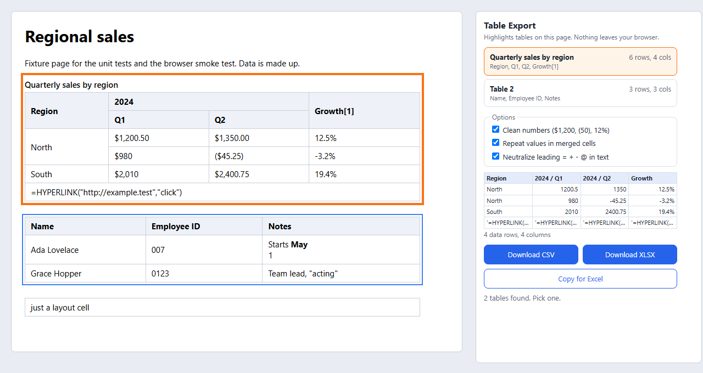

# table-export-extension

[](https://github.com/chasebuilds/table-export-extension/actions/workflows/ci.yml)   [](LICENSE)

A Chrome and Edge extension that finds the tables on the page you are looking at, outlines them, and exports the one you pick to CSV or XLSX. A third button copies it as tab-separated text so it pastes straight into Excel or Google Sheets.



## What it does

- Lists every real data table on the page (at least 2 rows and 2 columns, not hidden) and outlines them in blue. Picking one outlines it in orange and scrolls to it.
- **Merged cells:** `rowspan` and `colspan` are expanded into a rectangular grid. By default the merged value is repeated in every cell it covers, which is what you want for sorting and filtering. Turn that off and only the top-left cell keeps the value, and XLSX output keeps the merge itself.
- **Headers:** stacked header rows become one row, so `2024` over `Q1` becomes `2024 / Q1`. Footnote markers like `[1]` and a trailing `*` are removed, empty headers become `Column 3`, and repeated names become `Total`, `Total_2`.
- **Number cleanup** (can be switched off): `$1,200.50` becomes `1200.5`, `(45.25)` becomes `-45.25`, `1.234,56` becomes `1234.56`, `12.5%` stays `12.5%` in CSV and TSV and becomes a real percent-formatted number in XLSX. Anything else stays text. Ids with leading zeros (`007`) and numbers with more than 15 digits stay text so they are not damaged.
- **Formula guard:** text that starts with `=`, `+`, `-` or `@` gets a leading apostrophe in CSV and TSV, so a scraped cell cannot run as a formula when you open the file. XLSX stores such text as a plain string. You can turn this off.
- CSV is RFC 4180 with CRLF line ends and a UTF-8 byte order mark so Excel reads accents correctly.

## Install (unpacked)

Download `table-export-extension-v0.1.0.zip` from the [latest release](https://github.com/chasebuilds/table-export-extension/releases/latest) and unzip it, or build it yourself:

```
npm ci
npm run build        # writes dist/
```

Then open `chrome://extensions` (or `edge://extensions`), turn on Developer mode, choose **Load unpacked**, and select the `dist` folder. Click the toolbar icon on any page that has a table.

## Privacy

The extension asks for three permissions and nothing else:

| Permission | Why |
|---|---|
| `activeTab` | Read the tab you clicked the icon on, only until you leave or reload it. |
| `scripting` | Inject the small script that finds and reads the tables. |
| `downloads` | Save the CSV or XLSX file. |

There are no host permissions, no background service worker, no network requests, no analytics, and no stored data. The table text is read in the page, handed to the popup, converted there, and saved or copied by you. The SheetJS library that writes XLSX is bundled, not loaded from a server. You can check this: search `src/` for `fetch`, `XMLHttpRequest` or `WebSocket`.

## Tests

```
npm run typecheck    # TypeScript strict, noUncheckedIndexedAccess
npm run lint         # ESLint
npm test             # 49 unit tests (vitest + jsdom)
npm run smoke        # loads the unpacked extension in Chromium and drives it
```

- **Unit tests** cover table parsing on a jsdom fixture page (rowspan, colspan, `rowspan=0`, nested tables, footnote refs, ragged rows), stacked headers, currency, percent, negatives in parentheses, European separators, leading-zero ids, CSV quoting, TSV, formula guard, and an XLSX round trip that reads the file back.
- **Smoke test** ([e2e/smoke.spec.ts](e2e/smoke.spec.ts)) starts Playwright Chromium with the extension loaded, serves the fixture page from `127.0.0.1`, and checks that the popup lists two tables, outlines them on the page, shows the cleaned preview, downloads a CSV and an XLSX whose contents it reads back, and passes the right TSV to the clipboard call. It runs in CI.

### Why the smoke test uses a separate build

A script cannot click the toolbar icon, and clicking it is what grants `activeTab`. So `npm run build:test` produces `dist-test/` with `http://127.0.0.1/*` host access and an empty service worker added, and the test opens `popup.html?tabId=N` as a normal tab. The release build (`dist/`, the zip) has neither.

### Manual check on a real page

1. Load `dist/` unpacked as above.
2. Open any page with a table, for example a Wikipedia list or an HTML report.
3. Click the icon. Tables should get a blue outline; click one in the list and it turns orange.
4. Download CSV, open it in Excel, and check the headers and numbers. Use **Copy for Excel** and paste into a sheet.

## Limitations

- Only `<table>` elements. Grids built from `<div>`s, canvas charts and images of tables are not found.
- Tables inside iframes and shadow DOM are not scanned.
- `rowspan="0"` is read as "to the end of the table", not "to the end of the row group".
- Cell text is the visible text. Links, images, and formatting are dropped.
- Number cleanup guesses from the text alone. `1,234` is read as 1234 (US style), and a column that mixes number formats is converted cell by cell. Turn cleanup off when that is wrong for your data.
- Percentages are exported as text like `12.5%` in CSV and TSV. Excel and Sheets read that back as a percent, but other tools may not.
- Pages that the browser protects (`chrome://`, the Chrome Web Store, some PDF viewers) cannot be read by any extension. The popup says so.
- Not published to the Chrome Web Store. Install is unpacked.
- The clipboard step in the smoke test is a stub of `navigator.clipboard.writeText`, because headless Chromium has no real clipboard to read. The real paste into Excel is a manual check.

## Layout

```
src/parse.ts       DOM table to rectangular grid (spans, header rows)
src/transform.ts   headers, number cleanup, merged-cell handling, formula guard
src/format.ts      CSV, TSV, XLSX writers
src/content.ts     injected page script: find, outline, read
src/popup.ts       popup UI, downloads, clipboard
e2e/               Playwright smoke test and harness
```

## License

MIT, see [LICENSE](LICENSE).
